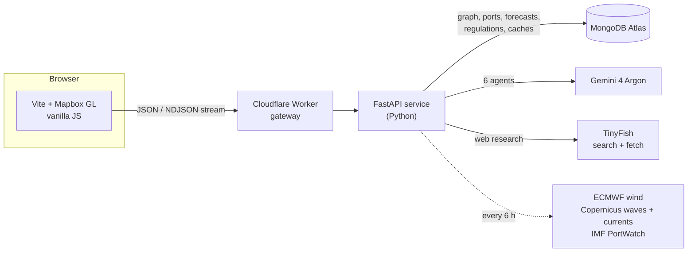

# SmoothSail

**Plan a container voyage and find out what could stop it, before the ship leaves port.**

SmoothSail compares the fastest, cheapest and lowest-CO₂ routes between two ports, using live wind, wave and current forecasts. AI agents then check the voyage and its cargo for compliance risks. Every finding cites the official source it is based on.

---

## The problem

Before a ship sails, someone has to answer two questions:

1. **Which route?** The shortest line on a map is rarely the best voyage. Weather slows ships down. Canals add tolls and waiting time. Going faster burns more fuel and emits more CO₂, which costs money now that shipping is part of the EU Emissions Trading System.
2. **Can this voyage go ahead as planned?** One voyage can be subject to EU carbon allowances, emission control areas, customs declarations, sanctions screening, war-risk insurance areas and dangerous-goods rules. All of these depend on the route, the cargo and the specific ship.

Today these answers are spread across forecast portals, canal tariff PDFs, customs websites, sanctions lists and regulation texts. Pulling them together is slow manual work. Missing one item, such as an undeclared lithium battery shipment or a vessel on a sanctions list, can mean fines, delays or a detained ship.

## The solution

SmoothSail puts route planning and compliance screening in one flow:

| Step | What you do | What SmoothSail does |
|---|---|---|
| 1. Plan | Pick two ports and a departure date | Calculates the **Fastest**, **Cheapest** and **Lowest CO₂** voyages, with ETA, distance, fuel, cost and emissions for each |
| 2. Explore | Open a route on the map | Draws the exact path with wave and wind overlays and plays the voyage back over time |
| 3. Check | Optionally upload a cargo manifest and enter the ship's IMO number | Runs five specialist AI agents in parallel: **security, environment, trade, sanctions and dangerous goods**. A sixth agent researches **port congestion** |
| 4. Understand | Read the findings | Each finding has a severity, a recommended action, any cost estimate and numbered citations to official sources. You can ask follow-up questions about it |
| 5. Adapt | If a port is congested, click **Reroute** | Suggests the nearest alternative port and lets you compare the original and alternative routes side by side |
| 6. Act | Export | Produces a voyage checklist as a PDF or a zip that includes the source documents |

Findings arrive as each agent finishes, so the route appears quickly and compliance results fill in behind it.

---

## How it works



### 1. Route planning

A route request runs these steps in a single call, with no job queue and no polling:

1. **Resolve the ports.** Ports come from UN/LOCODE, cross-checked against the World Port Index. Each port has an offshore approach point, so routes start at sea rather than at a city centre.
2. **Load the sea network.** The network is Eurostat's **SeaRoute** graph, held in **networkx**. Any edge that crosses land in the high-resolution **GSHHG** coastlines is removed. Only the reviewed Suez and Panama canal corridors are allowed through.
3. **Generate candidate paths.** Paths are weighted separately for time, cost, fuel and weather exposure, and canal bypasses are tried as well.
4. **Simulate each path.** Each path is run at 12, 14 and 16 knots. Waves slow the ship through the water, currents change its speed over ground, and canals add tolls and waiting time.
5. **Pick the winners.** The service keeps the fastest, cheapest and lowest-CO₂ result and returns one self-contained report with geometry, timed segments, cost and emission breakdowns and forecast coverage.

Forecasts are downloaded by a background job every six hours and cached in Atlas. A route request never waits on a weather download.

### 2. Data in MongoDB Atlas

All reference data lives in one Atlas database. That one database also provides the search engine, the geospatial database and the file store:

| Atlas feature | What SmoothSail uses it for |
|---|---|
| **Atlas Search** | Port autocomplete that tolerates typos ("Roterdam" finds Rotterdam). Full-text search over regulation passages for the agents |
| **Geospatial indexes** (`$geoNear`, `$geoIntersects`) | Finding the nearest alternative port. Checking which maritime zones and restrictions a route crosses |
| **GridFS** | Large forecast grids, detailed coastline geometry and the original regulation PDFs |
| **TTL indexes** | Expiring caches for congestion research and external API responses |
| **Flexible documents** | Adding new data sources (PortWatch, sanctions lists, tariffs) without schema migrations |

Voyages, cargo text and uploaded documents are **never stored**. They exist only in memory for the length of the request.

### 3. Agent orchestration with Gemini 4 Argon

When you ask for a compliance check (`POST /voyages/analyse`), the backend:

1. **Starts everything at once.** Route calculation, Atlas reference retrieval, public API lookups and congestion research all begin when the request arrives.
2. **Builds one shared voyage brief** once the routes are ready. The brief covers every route, the ports, passages, costs, emissions, weather coverage and the cargo. The backend also runs deterministic Python calculations, such as EU ETS allowance estimates and zone intersections.
3. **Fans out to five Argon specialists in parallel**, one per category, each with its own focused prompt. Each specialist can call read-only tools:
   - `research_web`: TinyFish search and page fetch
   - `lookup_reference`: Atlas Search over stored regulation passages
   - `read_route_report`: detailed geometry and timed segments, read only when needed
4. **Streams results as NDJSON**, sending each assessment to the browser as soon as it is done.

Each specialist gets at most **two model turns**. In the first turn it can call up to four tools, which run in parallel. In the second turn the tools are removed and it must answer in a strict JSON schema.

**Trust rules.** The model never has the final word. The backend checks every answer before it reaches the screen:

- A web citation must come from the tool results, point to an approved official domain, and **quote a passage that actually appears on the fetched page**.
- A finding without official evidence is downgraded to *unverified*.
- Costs must come from a Python calculation, never from the model.
- A sanctions-list match is shown as *estimated*, never *confirmed*. A name match alone does not prove a voyage is prohibited.
- If a check fails, it is reported as unavailable. A failed check never counts as clearance.

Model research retains its cost controls: 6 concurrent model calls and 60 model calls per hour. Route analyses no longer have a separate two-request admission gate; the single container's available CPU and memory still determine practical throughput.

---

## Tech stack

| Layer | Tools |
|---|---|
| Frontend | Vanilla JavaScript, Vite, Mapbox GL, Web Workers with a WebGL wave layer, d3-contour |
| Backend | Python 3.11+, FastAPI, networkx, xarray, pydantic, uv |
| Data | MongoDB Atlas: Atlas Search, geospatial indexes, GridFS, TTL indexes |
| AI | Gemini 4 Argon specialist agents, TinyFish web search and fetch |
| Data sources | UN/LOCODE, World Port Index, Eurostat SeaRoute, GSHHG, Natural Earth, ECMWF Open Data, Copernicus Marine, IMF PortWatch, canal authority tariffs, OSRM |
| Hosting | Cloudflare Workers gateway in front of the Python service |

---

## Run it locally

### Frontend

Requires Node.js 22 or later.

```sh
npm ci
cp .env.example .env.local      # add your Mapbox public token
npm run dev -- --port 3200
```

Open http://localhost:3200. By default the frontend uses the deployed API.

### Backend (optional)

Requires Python 3.11 or later and [uv](https://docs.astral.sh/uv/).

```sh
cd route-planning-api
uv sync --extra dev --extra providers
cp .env.example .env            # Atlas, Copernicus and Gemini keys go here, never in VITE_ variables
.venv/bin/python -m uvicorn service.main:app --host 127.0.0.1 --port 8766
```

Then set `VITE_ROUTE_API_BASE_URL=/local-api` in `.env.local`. Vite proxies `/local-api` to port 8766.

- `TIDELINE_MODE=demo` runs offline on a small built-in network.
- `TIDELINE_MODE=mongo` uses the full Atlas dataset.

### Tests

```sh
npm test                                              # frontend
cd route-planning-api && TIDELINE_MODE=demo uv run --extra dev pytest -q   # backend
```

---

## Project layout

```text
src/
  api/          HTTP client for the route service
  app/          Screens (landing, search, results, map), cargo intake, compliance chat, checklist
  data/         Route, compliance, congestion and reroute state and formatting
  globe/        Landing globe, flat map, wave and wind overlays, voyage playback, port alerts
tests/          Frontend tests
route-planning-api/
  service/      FastAPI app, routing, simulation, compliance agents, Atlas data layer
  scripts/      Data import, forecast refresh, Atlas setup, deployment, route verification
  cloudflare/   Worker gateway
  tests/        Backend tests
```

More detail:

- [route-planning-api/README.md](route-planning-api/README.md) covers data sources, Atlas collections and indexes, the cost model, the API schema and deployment.
- [route-planning-api/COMPLIANCE.md](route-planning-api/COMPLIANCE.md) covers the compliance endpoints, the streaming event format and the evidence rules.

---

## Limitations

- Fuel, cost and ETA are **planning estimates for a generic 3,500 TEU container ship**, not measurements for a particular vessel.
- Routes come from a heuristic network search, not a globally optimal solver. They are not navigation or pilotage plans.
- Compliance findings are **screening aids, not legal advice or clearance**. Missing information is shown as "needs input", never as "all clear".
- Congestion results describe current port conditions, not conditions when the ship arrives.

## Attribution

The map is rendered with Mapbox GL using the Mapbox Light style (© Mapbox, © OpenStreetMap). The globe dots and the fallback land mask use public-domain [Natural Earth](https://www.naturalearthdata.com/) data. Routing land screening uses GSHHG. Forecasts come from ECMWF Open Data and Copernicus Marine. The sea network is Eurostat SeaRoute.
